# Protótipo de alta fidelidade

Protótipo navegável do Clippo, gerado no Claude Design a partir do [prompt de telas](https://claude.ai/artifact/88Vp7qT43DokfXh7xS1qED). **É a referência visual das telas**: ao implementar uma tela, compare com as capturas abaixo. Os números exatos (cores, tamanhos, raios) estão no [design system](../04-design-system.md).

| Arquivo | O que é |
|---|---|
| `Clippo.dc.html` | O protótipo (todas as telas num arquivo só, com alternância claro/escuro). |
| `support.js` | Motor que faz o protótipo funcionar. **Não edite** e mantenha na mesma pasta do HTML. |
| `telas/` | Capturas de cada tela, nos temas claro e escuro. |

Projeto original no Claude Design: <https://claude.ai/design/p/bdc6b3ae-9e35-41cb-a4f8-39dccd78d8d5?file=Clippo.dc.html>

## Como abrir

1. Dê dois cliques em `Clippo.dc.html`. Ele abre no navegador.
2. **Precisa de internet**: o protótipo baixa o React e as fontes na hora.
3. Use os botões do topo para pular entre as telas (1 · Início … 5 · Perfil) e o seletor **Claro / Escuro** para trocar o tema.
4. Dá para navegar tocando: cards da Início abrem a sessão; o botão de gravar mostra os estados B → C (o aviso aparece e some sozinho); na tela preta, um toque revela "Encerrar sessão".

Se a página ficar em branco, sirva a pasta com um servidor local (ex.: extensão *Live Server* do VS Code, ou `npx serve` dentro de `docs/prototipos`) e abra pelo endereço que ele mostrar.

> Os dados (nomes, locais, lances) são fictícios, só para demonstração.

---

## Telas

| Tela | Claro | Escuro |
|---|---|---|
| 1 · Início | 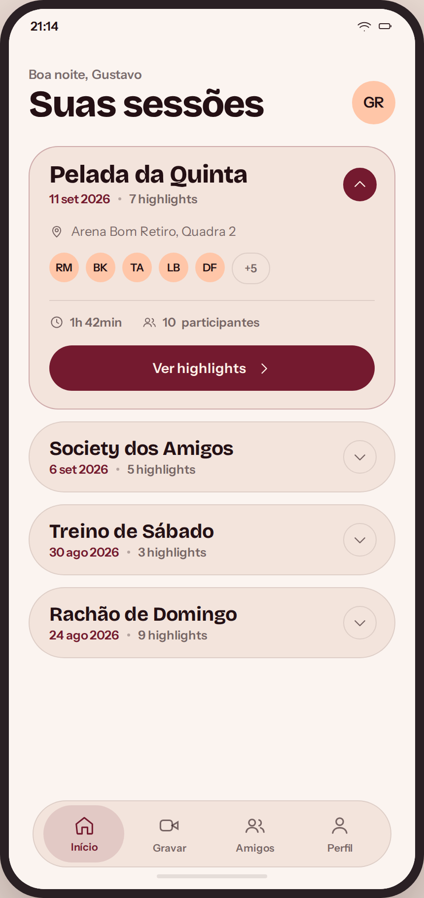 | 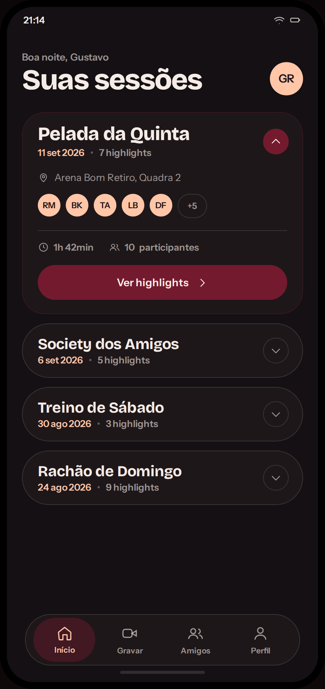 |
| 2 · Sessão | 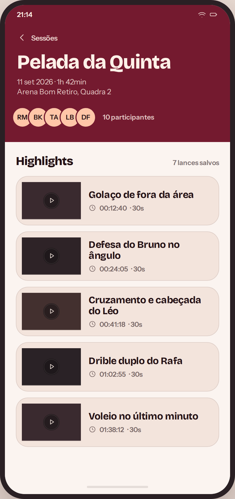 | 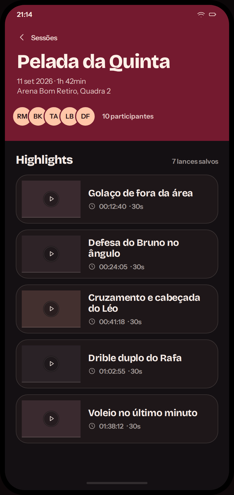 |
| 3A · Gravação — preparar | 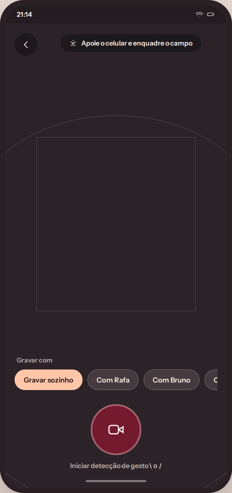 | 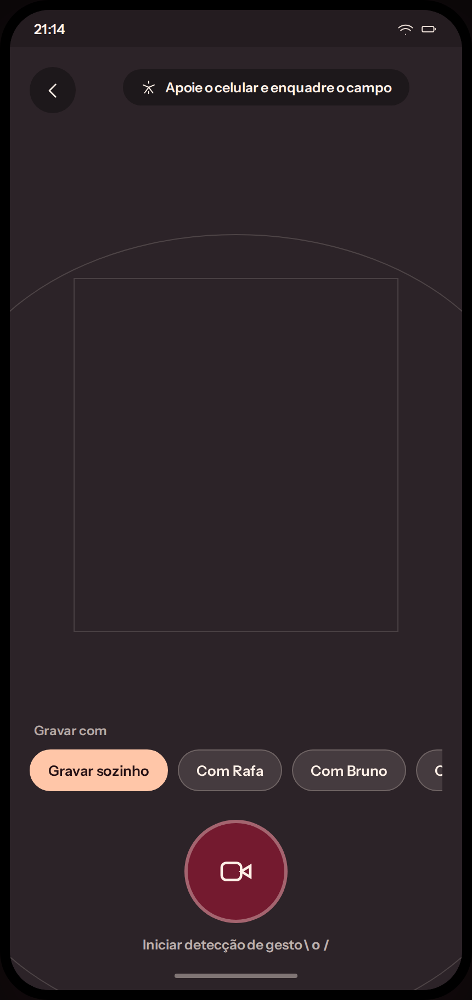 |
| 3B · Gravação — standby | 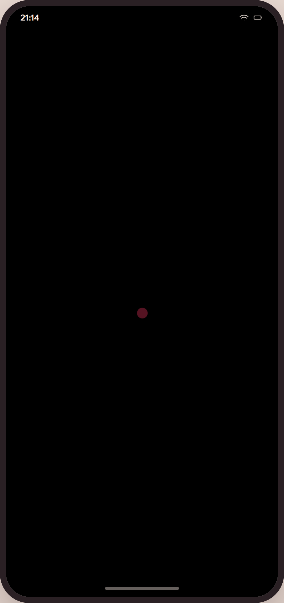 | 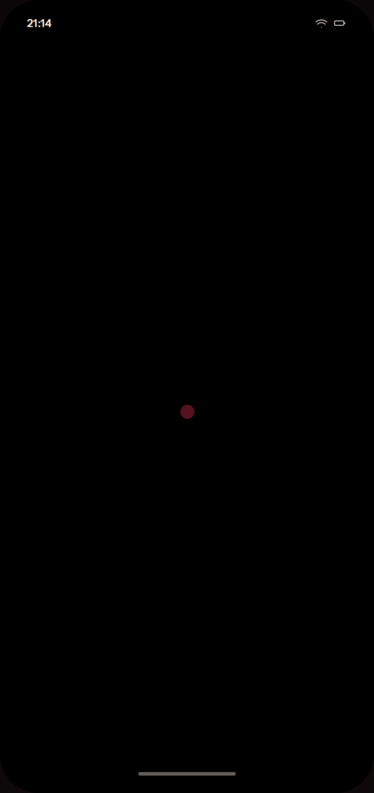 |
| 3C · Gravação — highlight salvo | 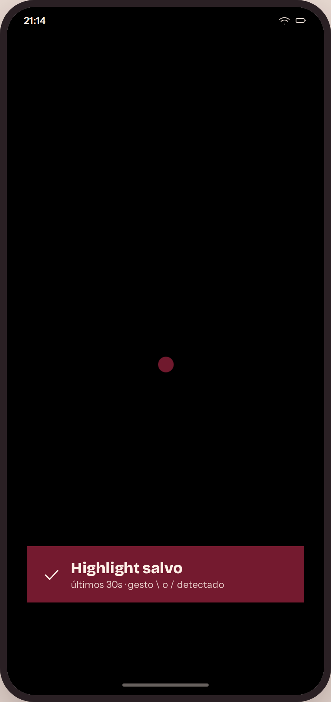 | 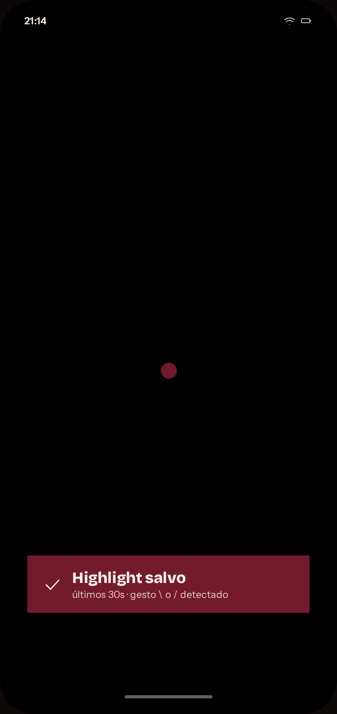 |
| 3D · Gravação — fim da sessão | 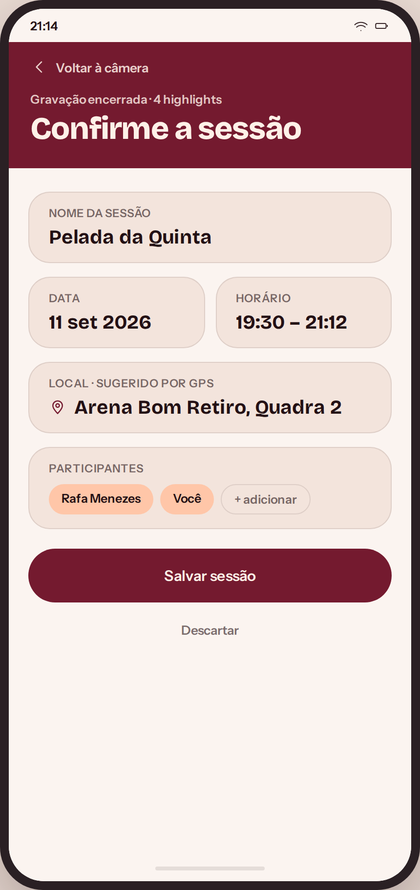 | 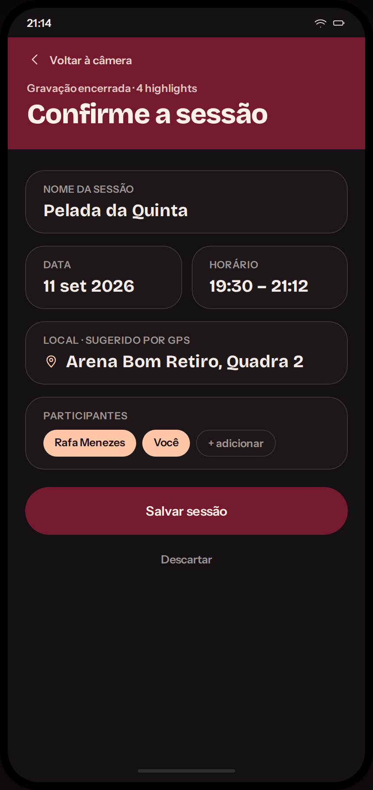 |
| 4 · Amigos | 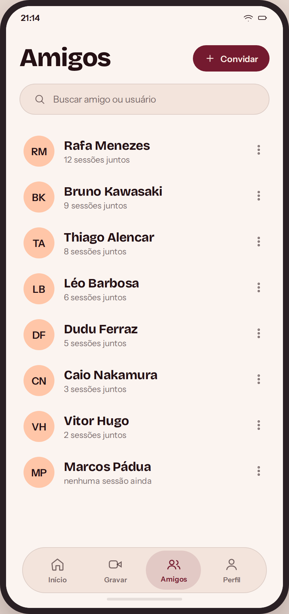 | 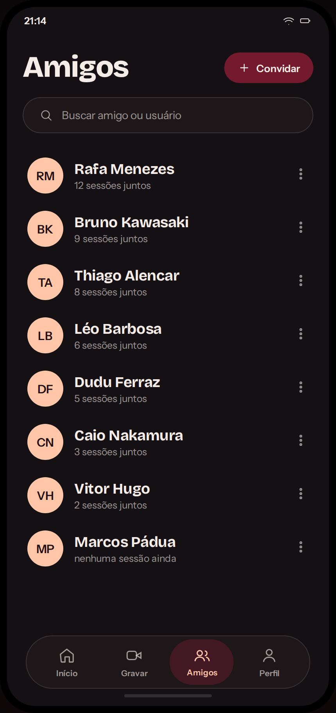 |
| 5 · Perfil | 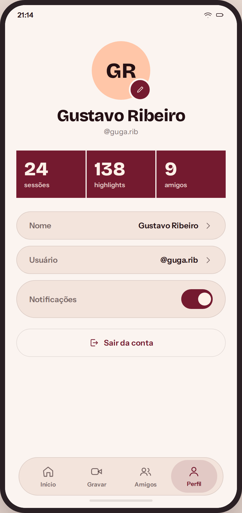 | 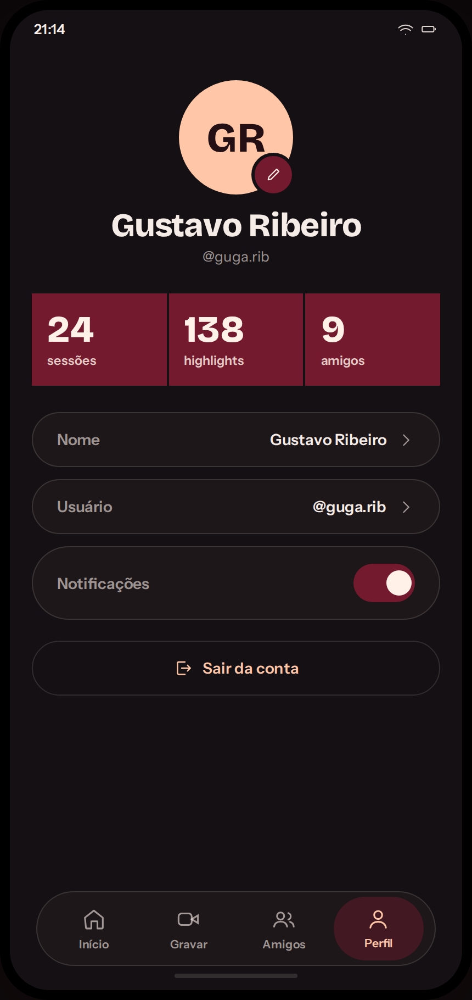 |

Ainda **não** estão no protótipo: Player do highlight e Entrada/onboarding (ver [03 — Telas](../03-telas.md)).

---

## Relação com a documentação

A documentação foi **alinhada ao protótipo** em 29/09/2026: cores, tipografia, raios, componentes, textos e ícones do [design system](../04-design-system.md), do [`design-tokens.json`](../design-tokens.json) e de [03 — Telas](../03-telas.md) seguem o que está aqui.

O que o protótipo **não cobre** e está só na documentação (marcado com 🟡):
- Telas de **Player** e **Entrada/onboarding**.
- Estados de **carregando, vazio, erro, sem internet e sem permissão**.
- Cores de **erro** e **esqueleto** de carregamento.
- Ações do menu **⋮** na lista de amigos e o menu do dono da sessão.

Se o protótipo mudar no Claude Design, substitua `Clippo.dc.html` aqui, refaça as capturas e atualize o design system no mesmo PR.
